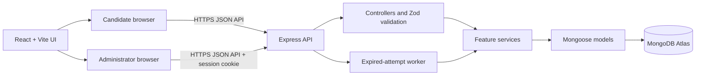
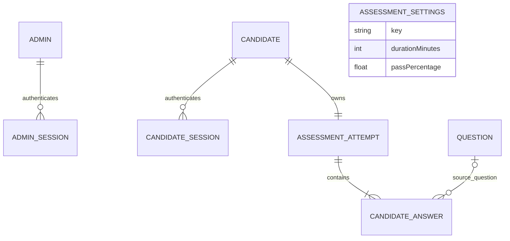

# Aptitude Assessment Dashboard

A full-stack aptitude assessment application for candidate registration, timed
tests, server-side scoring, and administrator review. Candidate answers and
assessment results are persisted in MongoDB; administrators manage question
content, settings, and candidate records through a protected portal.

## Features

### Candidate portal

- Validated candidate registration by One-time password using smtp mailer with duplicate-email recovery.
- Exactly 10 active questions are required to register for a new assessment.
- Randomized question order, one question at a time, navigation, and review marks.
- Server-timestamp countdown, autosubmission on expiry, and saved answer recovery.
- Scoring is calculated and stored by the backend: +2 correct, -1 incorrect,
  and 0 unanswered. Scores may be negative; percentage is net score divided by 20.
- Results and correct-answer review are available only after submission.

### Administrator portal

- Secure login, logout, protected APIs, and a live dashboard.
- Question CRUD, activation, filtering, and the 10-active-question limit.
- Candidate search, Pass/Fail filtering, sorting, backend pagination, saved
  answer review, and all/filtered CSV exports.
- Configurable test duration and pass percentage.
- Historical assessment answers are snapshots, and completed results are never
  recalculated when questions or settings change.

## Technology stack

| Area | Technologies |
|---|---|
| Frontend | React, Vite, TypeScript, Tailwind CSS, shadcn/ui-style components, Recharts |
| Backend | Node.js, Express 5, TypeScript, Zod |
| Persistence | MongoDB Atlas, Mongoose |
| Authentication | bcrypt password hashes, opaque server-side sessions, HttpOnly cookies |
| Testing | Node.js test runner, TypeScript execution through `tsx` |

## Architecture



The client uses feature-oriented pages under `client/src/features`. The server is
organized into Express middleware, route/controller/service modules, Mongoose
models, and seed scripts. API errors are normalized by centralized Express
error middleware.

```text
client/src/
  components/ui/                 Shared UI primitives
  features/admin/                Dashboard, settings, question and candidate pages
  features/candidate/            Registration and assessment flows
server/src/
  lib/                           Environment and database setup
  middleware/                    Authentication, rate limit, and error handling
  models/                        MongoDB collection schemas and indexes
  modules/admin/                 Admin auth, dashboard, settings, questions, candidates
  modules/assessment/            Instructions, attempts, answers, scoring
  modules/candidate/             Registration and validation
  migrations/                    MongoDB index initialization
  seed/                          Admin, default settings, and question bank
```

## Data model

The runtime stores these MongoDB collections:



| Collection | Important fields and constraints |
|---|---|
| `admins` | Name, unique lowercase email, bcrypt `passwordHash`, `ADMIN` role, last login |
| `admin_sessions` | Admin reference, unique SHA-256 token hash, expiry with TTL index |
| `candidate_sessions` | Candidate reference, unique SHA-256 token hash, expiry with TTL index |
| `candidate_verifications` | Unique email, bcrypt-hashed one-time code, 15-minute expiry, resend cooldown, failed-attempt count, pending profile data |
| `candidates` | Public ID, profile fields, unique lowercase email, age 18–60, 10-digit phone |
| `questions` | Four options, one answer key, category, difficulty, active flag |
| `assessment_settings` | Unique `key: "singleton"`, duration (1–180 whole minutes), pass percentage (0–100), question-bank revision |
| `assessment_attempts` | Unique candidate reference, status, shuffled question IDs, start/deadline and duration snapshots, saved scoring threshold and result |
| `candidate_answers` | Attempt/question references, unique attempt/question and attempt/position pairs, selected option, review flag, question text/options/answer-key snapshot |

An assessment attempt has one candidate and one answer document per question.
Answer documents retain the question wording, options, and correct answer so
question edits or deletion do not rewrite historical reviews. The question bank
uses a shared settings-document revision inside a MongoDB transaction to
serialize mutations at the 10-active-question limit. New attempts are blocked
unless the count is exactly 10.

## Requirements

- Node.js supported by Vite 7 (Node 20.19+ or 22.12+ recommended).
- npm.
- MongoDB Atlas or another MongoDB replica set. Assessment registration,
  question mutations, answer writes, and submissions use transactions; a
  standalone MongoDB server is insufficient for those operations.

## Installation and local development

From the repository root:

```powershell
npm install
Copy-Item server/.env.example server/.env
```

Edit `server/.env` with a MongoDB connection string and unique administrator
credentials. For Atlas, allow the development machine/server network in the
cluster's Network Access settings. Do not commit `.env` files.

Seed initial data, then run both applications:

```powershell
npm run db:seed
npm run dev
```

- Web client: <http://localhost:5173>
- API: <http://localhost:4000/api>
- API health: <http://localhost:4000/api/health>
- Database health: <http://localhost:4000/api/health/db>
- Administrator login: <http://localhost:5173/admin/login>

The seed command creates or updates the configured admin, sets assessment
defaults to 15 minutes and 60%, seeds the 10 question bank records, and
deactivates questions outside that seed set. Run it for initial setup only:
rerunning it will reset the admin password and assessment settings to the
current environment/default values.

## Environment variables

Configure these in `server/.env`:

| Variable | Required | Description |
|---|---:|---|
| `MONGO_URI` | Yes | MongoDB connection URI and database name |
| `PORT` | No | Express port; defaults to `4000` |
| `CLIENT_ORIGIN` | No | Allowed browser origin; defaults to `http://localhost:5173` |
| `ADMIN_EMAIL` | Yes | Email for the seeded administrator |
| `ADMIN_PASSWORD` | Yes | Initial administrator password; at least 8 characters |
| `BREVO_API_KEY` | Candidate portal | Brevo API key; keep it in the server's secret environment |
| `MAIL_FROM` | Candidate portal | Sender email address verified in Brevo |
| `NODE_ENV` | No | `development`, `test`, or `production`; production cookies are Secure |

There is no shared production admin password in the repository. The administrator
login is the `ADMIN_EMAIL` and `ADMIN_PASSWORD` configured at seed time.
Passwords are hashed with bcrypt before storage. To rotate the initial account
password, set a new secret and run the seed command deliberately.

## Database seed

```powershell
# Seed the administrator, default settings, and 10 aptitude questions
npm run db:seed
```

MongoDB is the only application database. Mongoose model indexes are initialized
when the API starts; the database seed command initializes the admin, settings,
and question bank.

## API reference

All routes are prefixed with `/api`. JSON request bodies use
`Content-Type: application/json`. Validation failures return HTTP 400; database
and application errors use a consistent `{ "error": { "code", "message" } }`
response. Admin routes require the `admin_session` cookie except login, logout,
and the explicitly protected session check.

### Health

| Method | Path | Purpose |
|---|---|---|
| `GET` | `/health` | API health |
| `GET` | `/health/db` | MongoDB ping |

### Candidate and assessment

| Method | Path | Purpose |
|---|---|---|
| `POST` | `/candidates/register` | Request an email verification code for registration/resume |
| `POST` | `/candidates/verify-email` | Verify the code and issue a candidate session |
| `GET` | `/assessment/:candidateId/instructions` | Instructions, duration, and question-bank availability |
| `POST` | `/assessment/:candidateId/start` | Start once or resume an active attempt |
| `GET` | `/assessment/:candidateId/state` | Restore saved answers and server-calculated remaining time |
| `PATCH` | `/assessment/:candidateId/answers/:answerId` | Save a selected option and/or review mark |
| `POST` | `/assessment/:candidateId/submit` | Submit once; body may set `{ "automatic": true }` only for an expired attempt |
| `GET` | `/assessment/:candidateId/result` | Read saved result and answer review after submission |

Registration fields: `fullName` (2–50 letters and spaces), `email`, `age`
(18–60), `phone` (10 digits), `qualification` (required), and optional `gender`
and `city`. The first request emails an eight-digit code; the verification
endpoint is the only point that returns a candidate ID. Codes expire in 15
minutes, have a 60-second resend cooldown, and are invalidated after five
incorrect entries. Request responses do not disclose whether an email already
has a candidate. An active unfinished attempt is resumed after successful email
verification; a completed attempt is rejected. Email uniqueness is enforced by
MongoDB.

Candidate assessment cookies are sent only to `/api/assessment`; browser
mutation requests must include the exact configured `CLIENT_ORIGIN`. A
candidate must verify the email before any assessment ID or session is issued.

The server stores `startedAt` and `deadlineAt`, snapshots duration at start,
and uses server time for remaining-time calculations. Answers are persisted as
they change. The server scores from saved question snapshots and saves the
passing percentage active at submission with the permanent Pass/Fail result.

### Administrator authentication and dashboard

| Method | Path | Purpose |
|---|---|---|
| `POST` | `/admin/auth/login` | Verify credentials and issue a session cookie |
| `POST` | `/admin/auth/logout` | Revoke the current session; returns 204 |
| `GET` | `/admin/auth/session` | Verify the current session |
| `GET` | `/admin/dashboard` | Database-backed metrics, score distribution, Pass/Fail and recent activity |

Sessions use random opaque tokens; only token hashes are persisted. Cookies
are HttpOnly, SameSite=Strict, scoped to `/api/admin`, and Secure in production.
Login is rate-limited to 10 attempts per IP per 15 minutes.

### Administrator settings

| Method | Path | Purpose |
|---|---|---|
| `GET` | `/admin/settings` | Read persisted duration and pass percentage |
| `PATCH` | `/admin/settings` | Update both settings |

Request body:

```json
{
  "durationMinutes": 15,
  "passPercentage": 60
}
```

Duration must be a whole number from 1 to 180; pass percentage may be a decimal
from 0 to 100. Duration is snapshotted when a test starts. The pass threshold
used by a result is snapshotted when that test is submitted, so changes affect
future submissions but never recalculate completed results.

### Administrator question bank and candidates

| Method | Path | Purpose |
|---|---|---|
| `GET` | `/admin/questions` | Filter/paginate with `category`, `difficulty`, `status`, `page`; includes availability |
| `POST` | `/admin/questions` | Create a four-option question with one correct key |
| `PATCH` | `/admin/questions/:questionId` | Edit or activate/deactivate a question |
| `DELETE` | `/admin/questions/:questionId` | Delete a question; historical snapshots remain |
| `GET` | `/admin/candidates` | Search/filter/sort; 10 records per page |
| `GET` | `/admin/candidates/:candidateId` | Candidate profile, stored result, and saved answer review |
| `GET` | `/admin/candidates/export.csv` | Export all completed results or the filtered result set |

Question list filters: `category` (`Quantitative`, `Logical Reasoning`,
`Verbal`), `difficulty` (`Easy`, `Medium`, `Hard`), `status` (`ALL`, `ACTIVE`,
`INACTIVE`), and `page`. Candidate list/export filters: `search` (name/email),
`resultStatus` (`ALL`, `PASS`, `FAIL`), `sortBy` (`date`, `score`), and
`sortOrder` (`asc`, `desc`). Pagination is performed by MongoDB; CSV export is
generated server-side and protects untrusted formula-leading text values.

## Security and historical integrity

- Admin authorization is enforced on the API, not only in the client router.
- Passwords use bcrypt; session tokens are cryptographically random and stored
  only as hashes.
- Candidate assessment access requires a server-side session issued only after
  email verification. Candidate sessions are opaque, HttpOnly,
  SameSite=Strict, scoped to assessment endpoints, and bound to the candidate
  ID in each route. Assessment mutations also validate the exact configured
  browser origin.
- Email verification codes are bcrypt-hashed, expire after 15 minutes, are
  single-use, allow at most five guesses, and are protected by resend and
  per-IP request limits. Brevo email delivery uses its HTTPS API; both email
  settings must be configured or verification fails closed.
- Express Helmet, JSON body-size limits, explicit CORS origin, Zod validation,
  unique database indexes, and centralized error handling are enabled.
- Correct answers are not returned in candidate test state; review keys are
  returned only after submission.
- Scores, percentages, pass thresholds, question snapshots, and result status
  are persisted. Dashboard and CSV result data use stored values.

## Testing and build

```powershell
npm test -w server
npm run build
```

The backend test suite covers scoring boundaries and negative marks, randomized
question shuffle behavior, candidate input and verification-code validation,
candidate/admin authentication middleware, question/settings validation, and explicit handling for
unsupported standalone-MongoDB transactions. Full API workflow testing requires
a MongoDB replica set because assessment and question mutations use
transactions; use a dedicated test database, never production data. The API
returns `503 MONGODB_REPLICA_SET_REQUIRED` for transaction-backed operations
when connected to a standalone MongoDB server.

## Deployment

1. Provision MongoDB Atlas with transaction support, configure network access,
   and use a least-privilege database user.
2. Set `MONGO_URI`, `ADMIN_EMAIL`, `ADMIN_PASSWORD`, `CLIENT_ORIGIN`,
   `BREVO_API_KEY`, `MAIL_FROM`, `NODE_ENV=production`, and the API `PORT` in
   the server's secret environment. Verify the sender address in Brevo first.
3. Install dependencies and build:

   ```powershell
   npm ci
   npm run build
   ```

4. Run `npm run db:seed` once for initial admin/settings/question data, then
   start the API with `npm run start -w server`.
5. Serve `client/dist` from a static host with SPA fallback to `index.html`.
   Route `/api/*` to the Express API through the same HTTPS origin where
   possible. Otherwise configure the exact frontend origin in `CLIENT_ORIGIN`.
6. Confirm `/api/health` and `/api/health/db`, test admin login, and verify that
   HTTPS is enabled so the production Secure session cookie is sent.

No hosted deployment or Atlas data migration has been performed as part of
development in this repository.

## AI tools and prompt themes

Implementation assistance was provided by GitHub Copilot in VS Code. Prompt
themes supplied during development included:

- Propose a full-stack assessment architecture before coding.
- Implement candidate registration, a timed/resumable assessment, and
  backend-only scoring with saved historical results.
- Add secure administrator authentication, dashboard analytics, question-bank
  management, candidate review, and CSV export.
- Add configurable assessment settings while preserving duration and result
  snapshots.
- Validate the finished application, document operational setup, and report
  environment-dependent limitations without overstating test results.

These are summaries of the requests, not verbatim prompt transcripts.

## Key Prompts

The selected prompts below are grouped by the purpose of the work they
requested.

### 1. Architecture and Requirements Analysis

  Act as a Senior Full Stack Software Architect.

I am building an Aptitude Assessment Dashboard for a Full Stack Developer recruitment assignment.

Read and follow the complete assignment requirements.

Before writing any code, analyze the requirements and provide:

1. Functional and non-functional requirements.
2. Proposed system architecture.
3. Frontend and backend folder structure.
4. Database ER diagram.
5. Database tables, relationships and constraints.
6. REST API endpoint specifications.
7. Candidate workflow.
8. Admin workflow.
9. Authentication and security approach.
10. Implementation roadmap.

Proposed stack:
- React + Vite + TypeScript
- Tailwind CSS + shadcn/ui
- Node.js + Express
- MongoDB Atlas(M0 Free cluster) + Mongoose ODM
- JWT or secure session authentication
- Recharts for analytics

Identify potential technical challenges, edge cases and ambiguities in the assignment.

Do not generate code yet. Explain your architectural decisions and wait for my approval.


### 2. Candidate Registration and Validation

This original prompt requested Prisma; the final implementation uses
MongoDB/Mongoose, as documented in the architecture and setup sections.

Implement the complete candidate registration module according to the assignment.

Requirements:

- Full name: 2–50 characters, letters and spaces only.
- Email: valid format and unique.
- Age: 18–60.
- Phone: exactly 10 digits.
- Gender: optional.
- Highest qualification: required.
- City: optional.

Implement:

1. Responsive registration UI.
2. Frontend validation using React Hook Form and Zod.
3. Backend validation.
4. Candidate registration API.
5. Database persistence using Prisma.
6. Duplicate email prevention.
7. Friendly error and success messages.
8. Loading states and form submission handling.

Ensure duplicate registrations are prevented at the database level as well.

Use a polished corporate SaaS design. Do not use dummy data.

Test valid registration, invalid inputs and duplicate email scenarios before completing.

### 3. Candidate Assessment Experience

Implement the complete candidate aptitude examination module.

Requirements:

- Exactly 10 questions.
- Four options per question.
- 15-minute default duration.
- +2 for correct answers.
- -1 for incorrect answers.
- 0 for unanswered answers.

Implement:

1. Assessment instructions page.
2. Start test functionality.
3. Randomized question order for each candidate.
4. One question at a time.
5. Previous and Next navigation.
6. Question palette.
7. Answered, unanswered and marked-for-review states.
8. Countdown timer.
9. Answer persistence.
10. Refresh recovery.
11. Manual submission confirmation.
12. Automatic submission when time expires.

Critical requirements:

- Calculate remaining time using server-authoritative timestamps.
- Save answers through backend APIs.
- Do not expose correct answers before submission.
- Prevent timer resets through page refresh.
- Prevent duplicate submissions.
- Handle expired and invalid assessment attempts safely.

Test all navigation, persistence, timer and submission scenarios.

Use a clean, distraction-free examination UI suitable for a professional aptitude test.

### 4. Backend Scoring and Candidate Results

Implement the complete assessment scoring and result module.

Calculate scores exclusively on the backend.

Scoring:
- Correct: +2.
- Incorrect: -1.
- Unattempted: 0.
- Maximum score: 20.
- Percentage = (Net Score / 20) × 100.
- Default passing percentage: 60%.

Display:

- Total score.
- Percentage.
- Correct answers.
- Incorrect answers.
- Unattempted questions.
- Marks deducted.
- Time taken.
- Pass/Fail status.

Allow candidates to review their answers and correct answers only after submission.

Ensure negative scores are supported and not artificially restricted to zero.

Store the complete result in the database.

Write unit tests for scoring calculations, including negative scores and boundary cases.

### 5. Administrator Question and Candidate Management

Implement the complete admin management modules.

A. Question management:

- View questions.
- Add questions.
- Edit questions.
- Delete questions.
- Activate/deactivate questions.
- Category and difficulty filters.
- Exactly four options per question.
- Exactly one correct answer.

Enforce the 10-active-question limit and prevent assessment attempts from starting when fewer than 10 active questions exist.

Preserve historical assessment records when questions are edited or deactivated.

B. Candidate management:

Create a professional data table with:
- Name.
- Email.
- Phone.
- Age.
- Score.
- Percentage.
- Pass/Fail.
- Attempt date.

Implement:
- Search by name and email.
- Pass/Fail filtering.
- Score sorting.
- Date sorting.
- Pagination with 10 records per page.
- Candidate detail view.
- Question-by-question answer review.
- CSV export of all results.
- CSV export of the filtered results.

Use backend pagination and filtering rather than loading the entire dataset into the browser.

All actions must be functional and connected to the database.


### 6. Senior Full-Stack Code Review

   Review the code you just implemented as a senior full-stack developer.

Do not immediately rewrite everything.

1. Identify bugs and potential edge cases.
2. Check whether the implementation follows the approved architecture.
3. Check frontend and backend validation.
4. Check database queries and relationships.
5. Identify security vulnerabilities.
6. Identify unnecessary code or duplicated logic.
7. Run the relevant tests and inspect the results.
8. Suggest improvements with reasons.

Fix confirmed issues and explain the important changes made.
